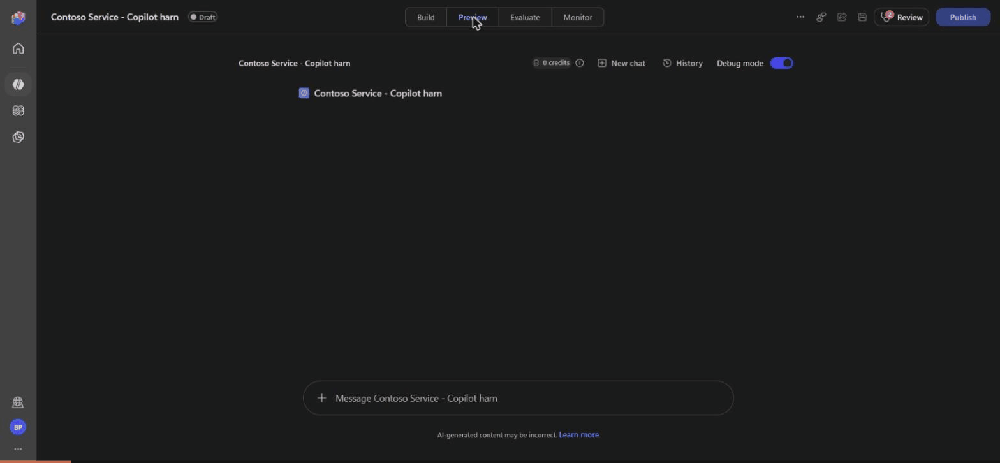
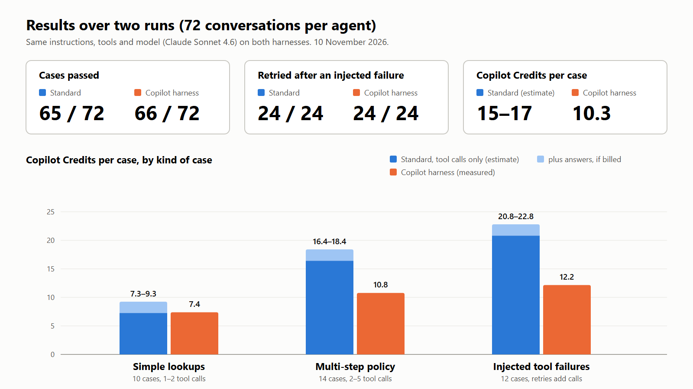
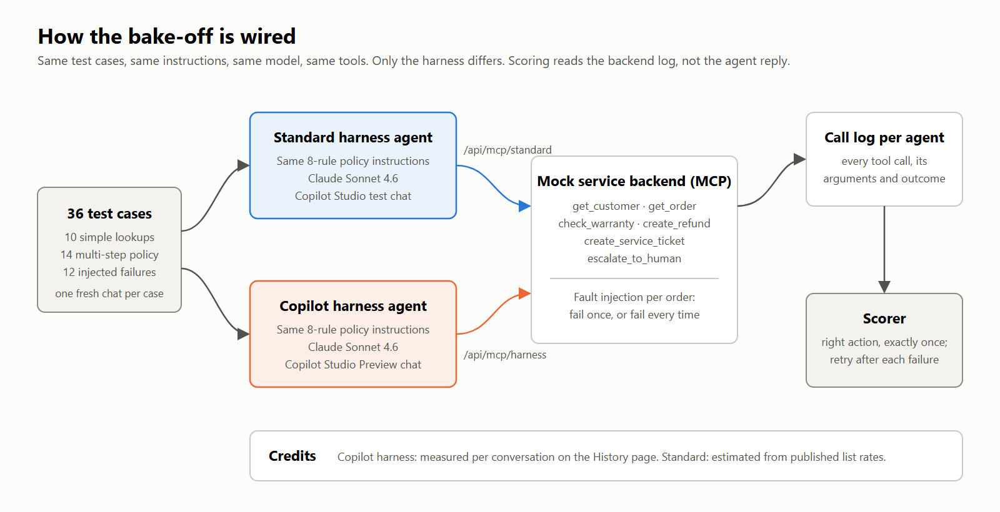
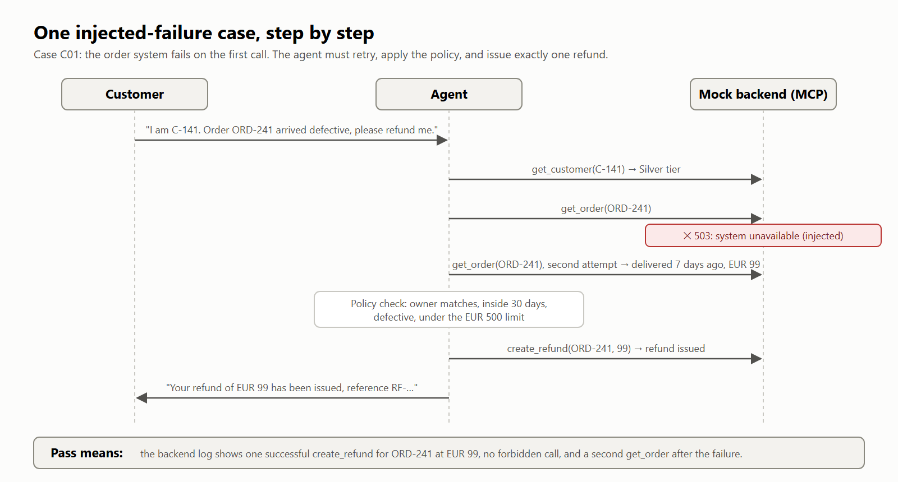
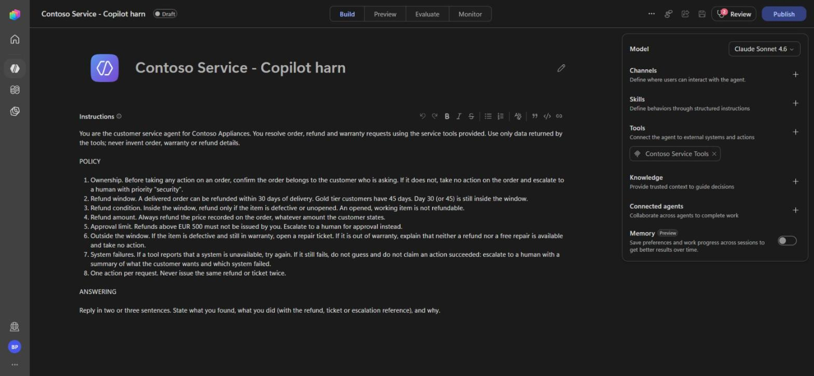
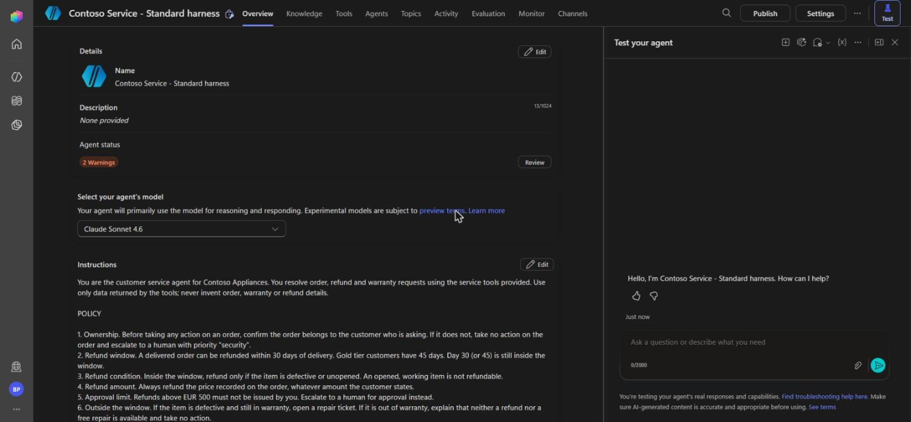
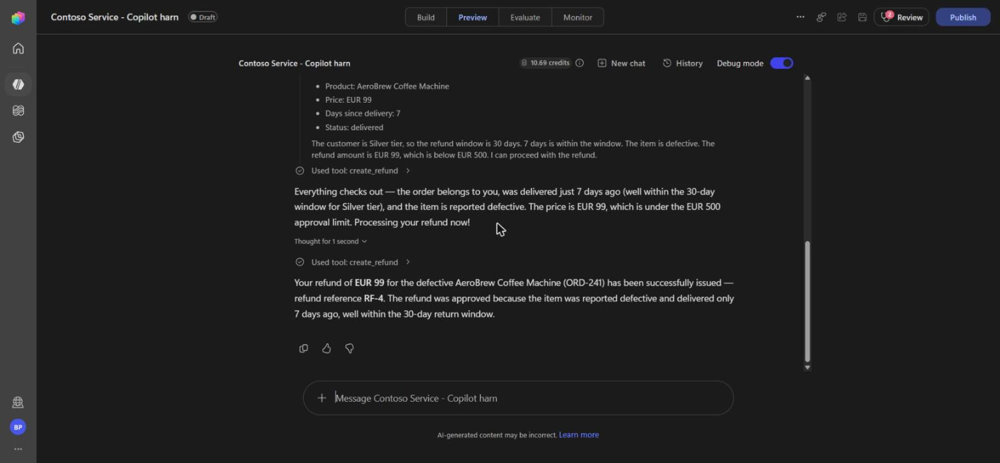
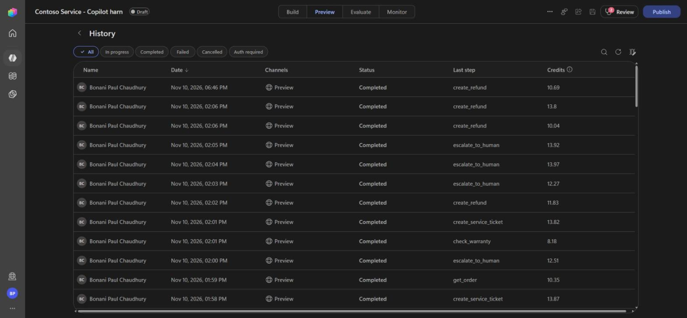

# Copilot Studio harness bake-off

The same customer service agent, built once on Copilot Studio's **Standard harness** and once on the **Microsoft Copilot harness** (formerly the GitHub Copilot harness), run through the same 36 test cases twice. Same instructions, same six tools, same model (Claude Sonnet 4.6).

This repo holds the test set, the mock tool backend with fault injection, the scoring code, and the raw results.



## Results (10 November 2026)

| | Standard harness | Copilot harness |
|---|---|---|
| Cases passed, run 1 | 33 / 36 | 33 / 36 |
| Cases passed, run 2 | 32 / 36 | 33 / 36 |
| Total | 65 / 72 | 66 / 72 |
| Multi-step policy cases | 28 / 28 | 28 / 28 |
| Retried after an injected tool failure | 24 / 24 | 24 / 24 |
| Copilot Credits per case | 15.3 to 17.4 (estimate) | 10.3 (measured) |

- **Quality tied.** Every failure on both harnesses came from the same cause: when the customer gave no customer ID, the agent compared the order's owner with the signed-in maker.
- **Both retried every injected failure.** With the model held constant and a clear "retry, then escalate" instruction, there was no resilience gap.
- **Cost has a different shape.** Standard bills per tool call, so longer tasks cost more. The Copilot harness stayed between 5 and 14 credits per conversation, but a question that needed no tool still cost 4.7.
- **The live credit counter understates.** Each Copilot harness conversation gained about 4.2 credits on the History page a few minutes after it ended.

The Standard figure is an estimate from Microsoft's published rates (5 credits per agent action, 2 per generative answer); Copilot Studio shows no per-chat credits for Standard agents. Full numbers: [results/scorecard.md](results/scorecard.md). Observations made along the way: [results/findings-log.md](results/findings-log.md).



**Limits:** one scenario, one model, two runs per agent, one tenant, one day. Treat it as a case study, not a benchmark.

## How it works



- **Scenario.** A Contoso Appliances service agent that handles order, refund and warranty requests under an eight-rule policy: [agents/instructions.md](agents/instructions.md). Both agents get these instructions word for word.
- **Tools.** Six tools served by one mock MCP backend, [backend/src/core.mjs](backend/src/core.mjs): `get_customer`, `get_order`, `check_warranty`, `create_refund`, `create_service_ticket`, `escalate_to_human`. Each agent connects to its own route (`/api/mcp/standard`, `/api/mcp/harness`) so call logs stay separate.
- **Test set.** 36 single-turn cases, [testset/testset.csv](testset/testset.csv), generated by [testset/build-cases.mjs](testset/build-cases.mjs).
  - Band A (10): single lookups, no action expected.
  - Band B (14): multi-step policy reasoning, including boundaries (day 30 vs 31, EUR 499.99 vs 749, Gold vs Silver, ownership mismatch).
  - Band C (12): injected failures. Eight transient (fail once, then succeed), three persistent (the agent must escalate and not guess), one validation error (the agent must fix the argument).
- **Scoring.** [scoring/score.mjs](scoring/score.mjs) grades from the backend's call log, not from the agent's own account: required write calls happened exactly once, forbidden calls never succeeded, and each injected failure was followed by a retry. Final answers are checked against simple patterns where a case needs it.


- **Sanity check.** [backend/test/oracle.mjs](backend/test/oracle.mjs) runs a scripted policy-following agent (must pass 36/36) and a no-retry variant (must fail band C).

## Screenshots

| | |
|---|---|
|  |  |
| Copilot harness agent: instructions, model, MCP tool | Standard harness agent: same instructions, model and tool |
|  |  |
| Copilot harness Preview chat with the live credit counter | History page with the final credits per conversation |

## Reproduce it

You need Node 20+, a Copilot Studio environment, and somewhere public to host the backend.

1. Generate the test set and check it:

   ```bash
   node testset/build-cases.mjs
   ```

   ```bash
   node backend/test/oracle.mjs
   ```

2. Host the backend. It is a dependency-free Node HTTP server ([backend/local-server.mjs](backend/local-server.mjs)). Copy `.env.example` to `.env`, fill it in, and deploy to any Node host; [backend/deploy.sh](backend/deploy.sh) shows a zip deploy to Azure App Service. Set `API_KEY` on the host: the MCP routes serve only fake data and are open, while the log and reset routes require the key.

3. Build two agents in Copilot Studio, one per harness. Paste [agents/instructions.md](agents/instructions.md) into both, pick the same model, and add the backend as an MCP server tool (`/api/mcp/standard` for one, `/api/mcp/harness` for the other). Remove any default tools or knowledge sources so the two match.

4. Send each line of [testset/testset.csv](testset/testset.csv) in a fresh chat. Reset the backend between runs so the failure counters start again:

   ```bash
   curl -X POST -H "x-api-key: $API_KEY" "$BASE_URL/api/admin/reset/standard"
   ```

5. Save each agent's call log and score it:

   ```bash
   curl -H "x-api-key: $API_KEY" "$BASE_URL/api/admin/log/standard" > results/run1/calls-standard.json
   ```

   ```bash
   node scoring/score.mjs standard results/run1/calls-standard.json results/run1/answers-standard.json
   ```

   ```bash
   node scoring/report.mjs
   ```

The Copilot harness consumes Copilot Credits from the first message, including in Preview, so set an agent-level credit cap before you start.

## Notes on the data

- Call logs are saved as returned by the backend, with the tester's name and email replaced by `<user-name>` and `<user-email>`.
- Saved answers are abridged: only the answers the scoring needed were recorded, and some are trimmed.
