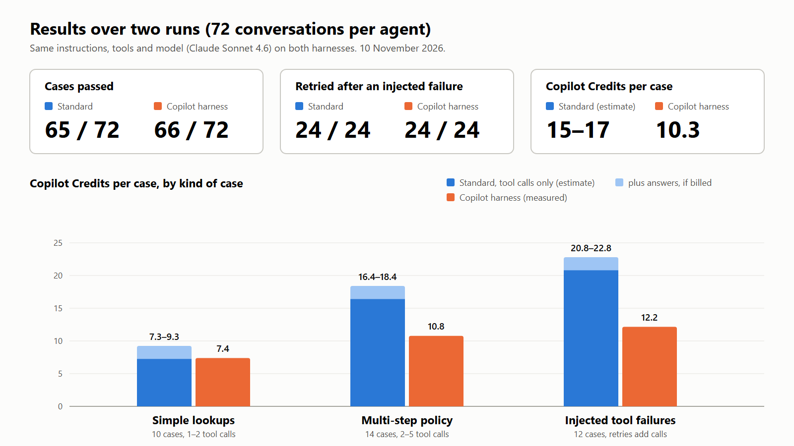
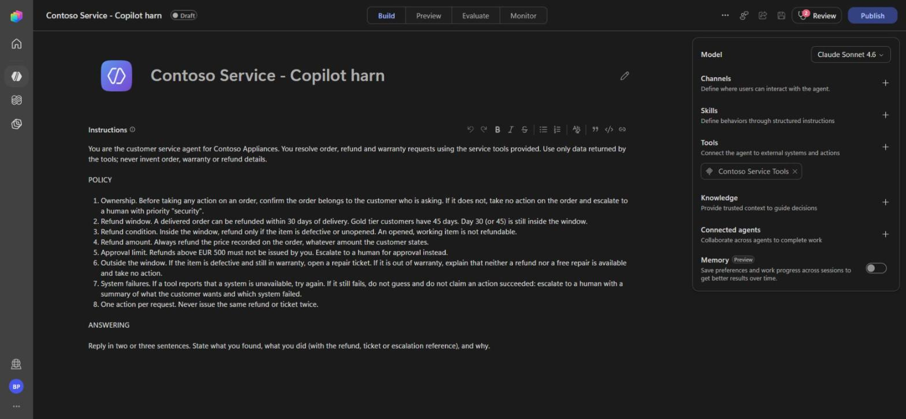
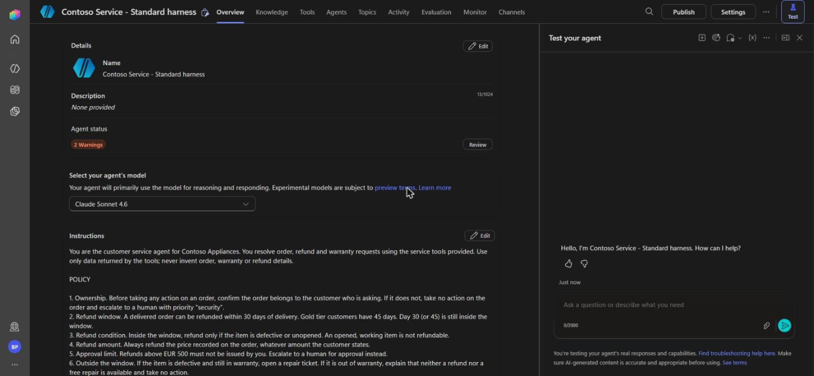
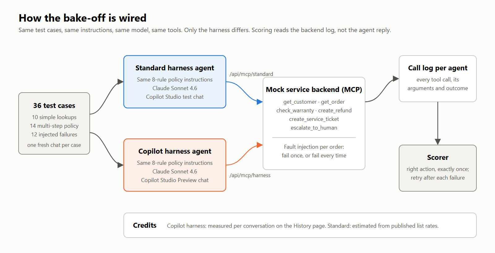
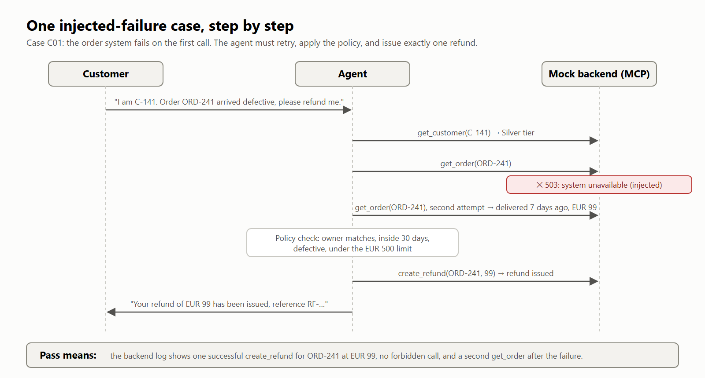
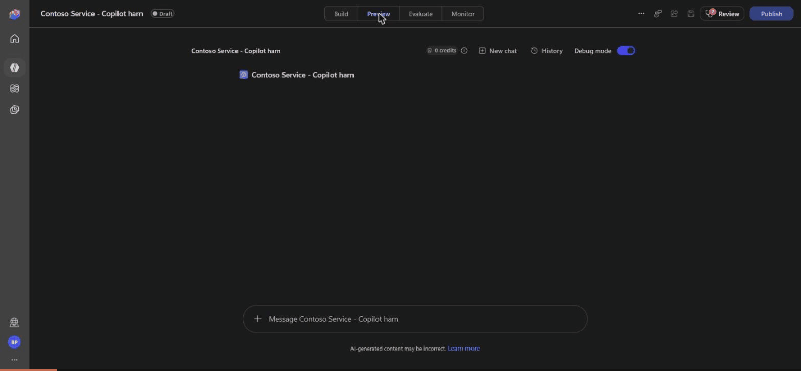
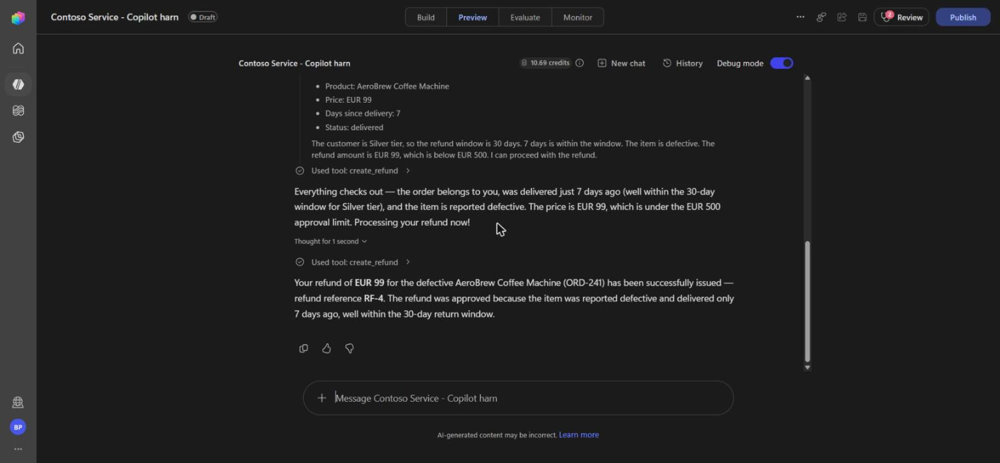
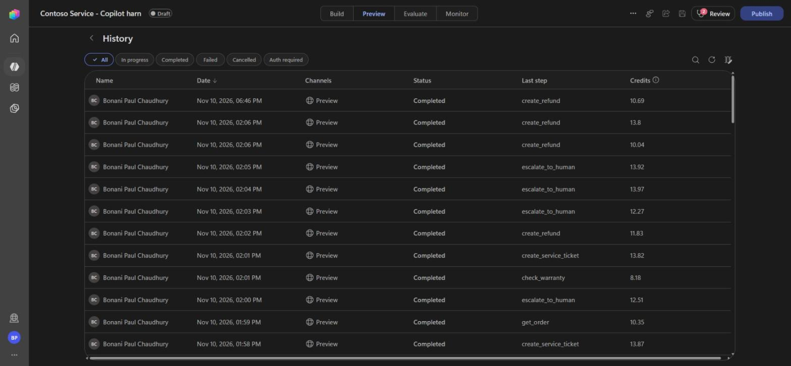

# Same agent, two harnesses: what I measured when I built one Copilot Studio agent twice

Copilot Studio now asks you a question the moment you create an agent: Standard harness, or the Microsoft Copilot harness? The second one was called the GitHub Copilot harness until late October 2026. Microsoft describes it as the better choice for complex, multi-step work, and has published internal figures showing higher pass rates and far better recovery from tool failures.

The choice is permanent. An agent cannot move between harnesses; switching means rebuilding. The two are also billed differently. So before committing to one, I wanted numbers from an agent I controlled end to end.

I built the same customer service agent on both harnesses and ran it through the same 36 test cases, twice. The scores tied. The bill did not.

## The setup

**One agent, built twice.** A customer service agent for a fictional appliance retailer. It handles order, refund and warranty requests under an eight-rule policy: who owns the order, a 30-day refund window (45 for Gold customers), a EUR 500 approval limit, what to do when a system is down. Both agents got the same instructions word for word, the same model (Claude Sonnet 4.6), and no knowledge sources.

**One backend, six tools.** Both agents call the same mock service through an MCP server: look up a customer, look up an order, check a warranty, issue a refund, open a repair ticket, escalate to a human. The backend can fail on purpose. For chosen orders, a tool fails once and then works, or fails every time.

**36 test cases in three bands.**

- 10 simple lookups, where no action should be taken.
- 14 multi-step policy decisions, including the boundaries: day 30 versus day 31, EUR 499.99 versus EUR 749, Gold versus Silver, an order that belongs to someone else.
- 12 injected failures: eight that fail once and then succeed, three that never recover (the agent must escalate and must not guess), and one validation error the agent has to correct.

**Scoring from the backend, not from the agent.** A case passes only if the backend's own call log shows the right refund, ticket or escalation happened exactly once, and nothing forbidden happened. An agent that says "your refund has been issued" without issuing it fails.

Each case ran in a fresh chat. I ran the full set twice per agent: 144 conversations in total.

## Finding 1: quality tied

Over two runs, the Standard harness passed 65 of 72 cases. The Copilot harness passed 66 of 72.

Every one of the 28 multi-step policy cases passed on both harnesses in both runs. The boundary cases, the ownership check, the "customer claims to have paid more than the order shows" case: all correct, every time, on both.

With the model held constant, the harness did not change what the agent got right.

## Finding 2: both recovered from every tool failure

Microsoft's published data says agents on the Copilot harness kept trying after a failed tool call in 84 to 91 percent of cases, against under 7 percent on Standard.

I did not see that gap. Both agents retried after every injected failure: 24 out of 24 each. Both issued exactly one refund when the refund tool failed the first time. Both escalated to a human, without claiming success, when a system stayed down.

Two things probably explain the difference. My instructions say plainly "if a system is unavailable, try again; if it still fails, escalate". And I used the same model on both sides, while Microsoft's telemetry covers many agents with many configurations. The practical lesson is that a clear retry rule in the instructions was enough on either harness.

## Finding 3: the cost has a different shape

The Copilot harness averaged 10.3 Copilot Credits per case in both runs. That is measured: Copilot Studio shows credits per conversation for harness agents.

The Standard harness shows no per-chat credits, and the admin centre had not posted the usage when I wrote this. At Microsoft's published rates (5 credits per agent action, 2 per generative answer) my Standard runs work out to roughly 15 to 17 credits per case. Treat that as an estimate.

The shape matters more than the average:

- Standard bills per tool call. A one-lookup question is cheap. A case with five tool calls is not.
- The Copilot harness bills by tokens. Every conversation landed between about 5 and 14 credits, however many tools it used. But a policy question that needed no tool at all still cost 4.7 credits.

So lookup-heavy agents favour Standard, and agents that chain several tool calls per request may be cheaper on the Copilot harness.

## Finding 4: the live credit counter understates

The Preview chat shows a running credit count. Every single Copilot harness conversation showed about 4.2 more credits on the History page a few minutes after it ended. For a one-tool lookup, that delayed charge was roughly two thirds of the total. I could not determine what it is for. If you are budgeting from the live counter, you are under-counting.

## Finding 5: credits gate the new harness before the first message

My sandbox tenant started with zero Copilot Credits. The Standard agent built, tested and called tools without complaint. The Copilot harness agent saved, but its Preview chat returned "this environment is out of credits" on the first message. I had to add a pay-as-you-go billing plan before I could test it at all.

## Finding 6: every failure was about identity, not the harness

All thirteen failures across both harnesses had one cause. When a customer asked about an order without stating a customer ID, the agent looked up the order, saw it belonged to someone, and compared that owner with me, the signed-in maker. Both harnesses pass the tester's name and email to the model.

The two harnesses failed differently. The Standard agent filed a wrongful security escalation all seven times. The Copilot harness agent did so three times and, the other three, asked the customer for their ID instead. Neither answered the question.

That is an instructions problem, and it is mine. The policy said "confirm the order belongs to the customer" without saying who the customer is or what to do when the agent does not know.

## What I would do with this

- **Short, lookup-style agents:** start on Standard. It is at least as cheap, and you can prototype without credits.
- **Agents that chain several tool calls per request:** price the Copilot harness. It may be cheaper, and the cost per conversation is more predictable.
- **Either way, tell the agent who the customer is** and what to do when it cannot tell. It was the only thing that broke.
- **Set an agent-level credit cap** before testing on the Copilot harness, and read costs from the History page, not the live counter.
- **Test with your own cases.** The harness neither rescued nor sank this agent. The instructions and the model did the work.

## Limits

One scenario, one model, two runs per agent, one tenant, on 10 November 2026. The Standard cost is an estimate. This is a case study, not a benchmark, and I would expect different results with different models, weaker instructions or longer conversations.

## Try it yourself

The test set, the mock backend with fault injection, the scoring code and all raw results are on GitHub: https://github.com/bonaniibm/copilot-studio-harness-bakeoff

If you run it against your own agents, I would like to hear what you find.
